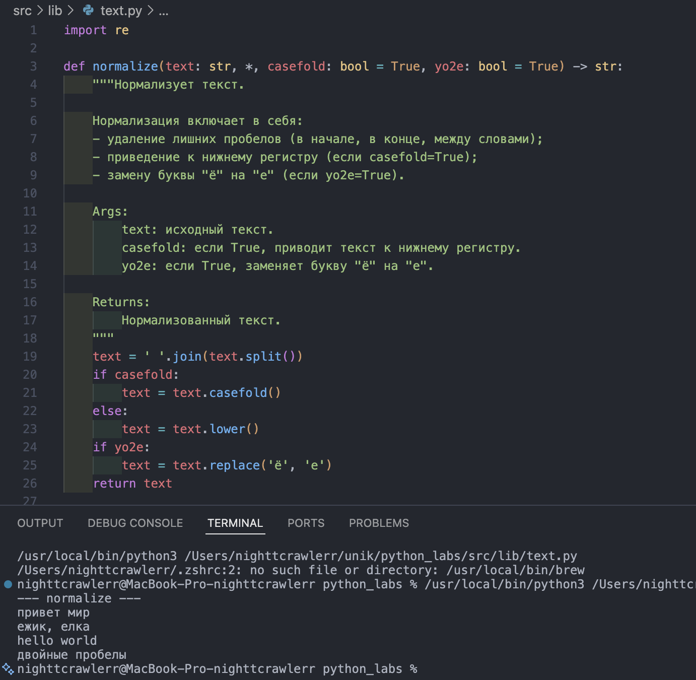
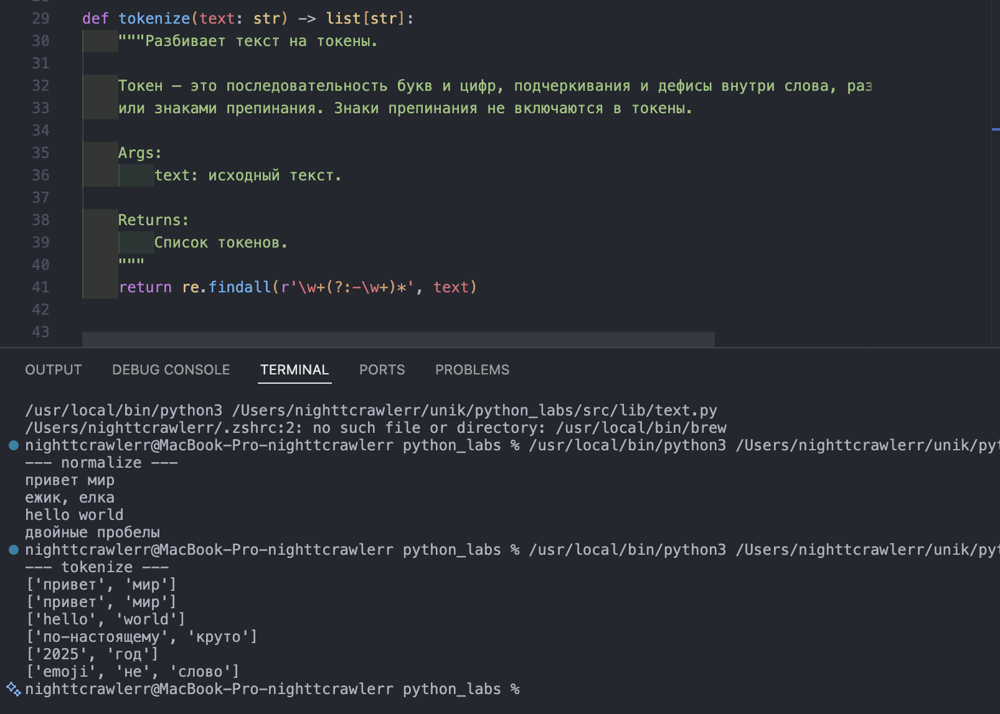
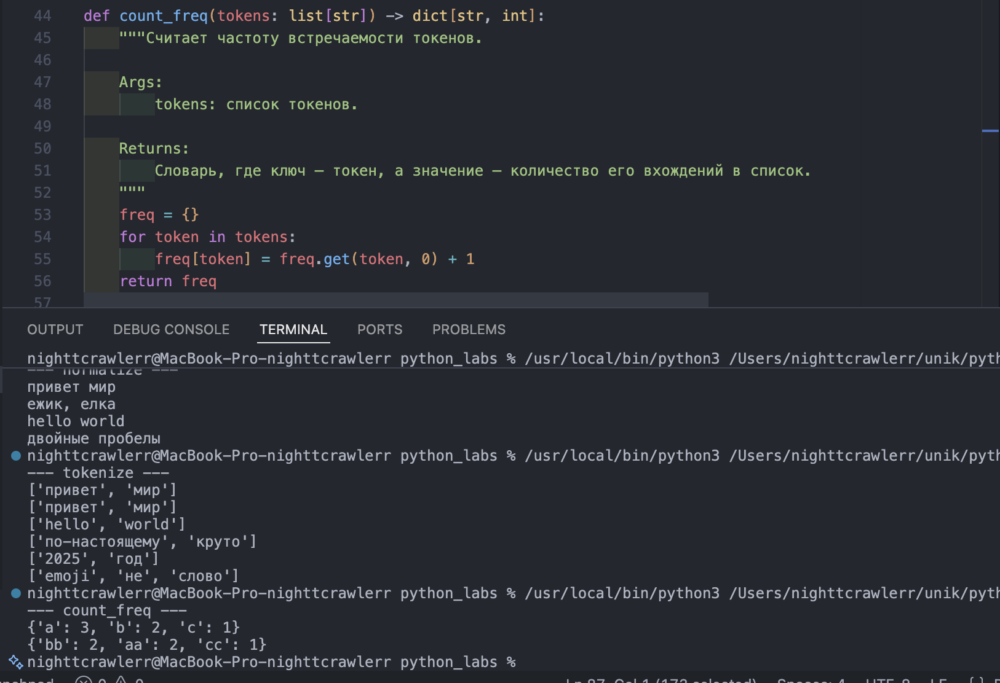
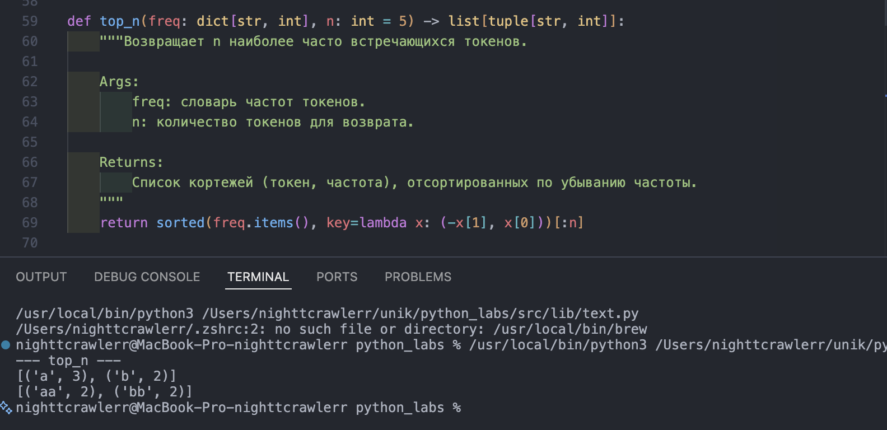
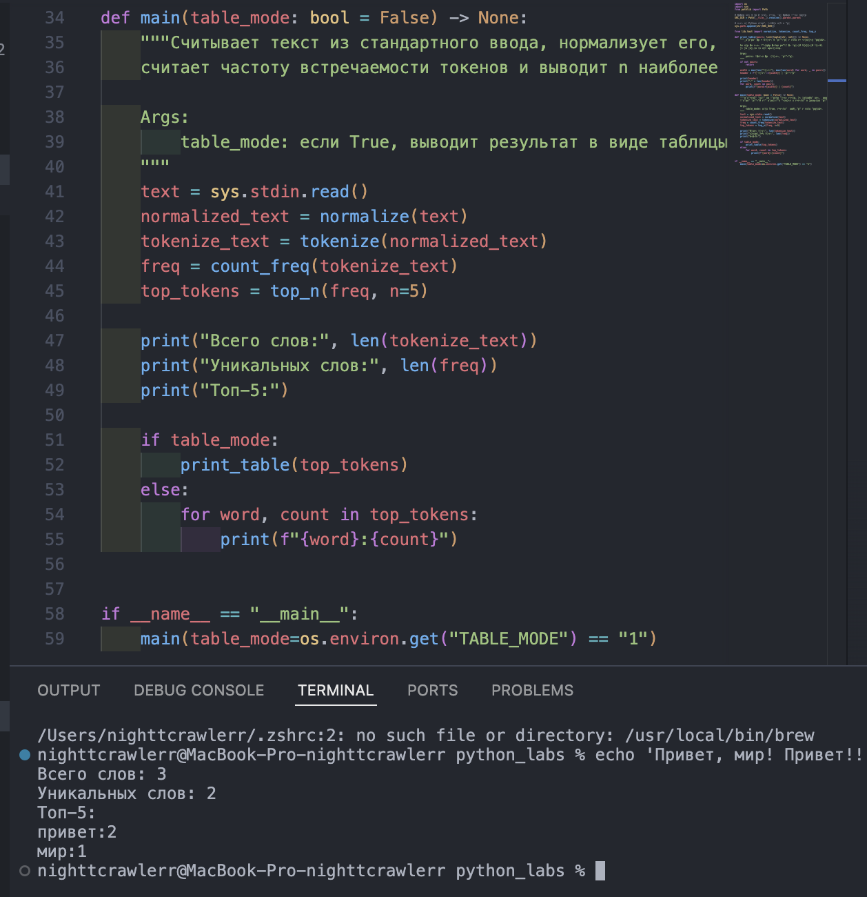
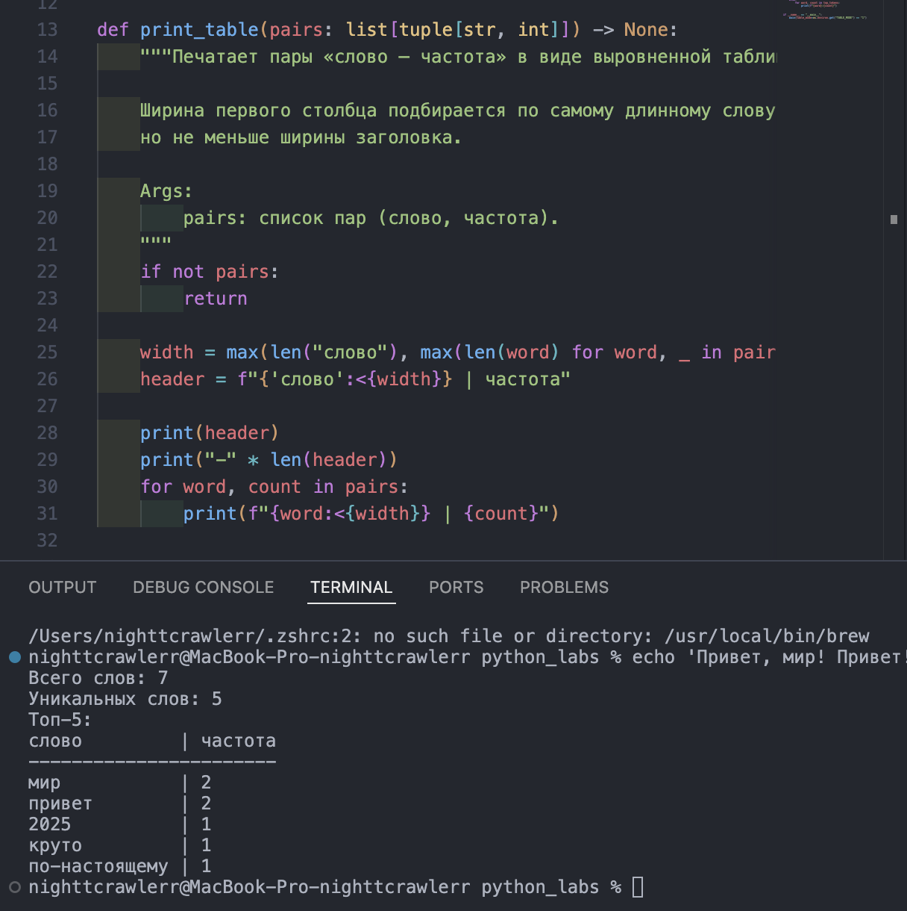

# Лабораторная 3 — тексты и частоты слов

Скрипт читает весь ввод до EOF, а не одну строку.

## Задание 1 — normalize

Приводит текст к единому виду: убирает лишние пробелы и переводы строк, понижает регистр, меняет «ё» на «е». Флаг casefold выбирает способ — casefold() или lower().

Файл: `src/lib/text.py`
Скрин: 

## Задание 2 — tokenize

Разбивает текст на слова регуляркой. Дефис внутри слова остаётся, числа считаются словами, эмодзи и знаки препинания выбрасываются.

Файл: `src/lib/text.py`
Скрин: 

## Задание 3 — count_freq

Считает, сколько раз встретилось каждое слово, возвращает словарь.

Файл: `src/lib/text.py`
Скрин: 

## Задание 4 — top_n

Возвращает топ-N самых частых слов. По убыванию частоты, а при одинаковой частоте по алфавиту.

Файл: `src/lib/text.py`
Скрин: 

## Задание 5 — text_stats.py

Читает текст из stdin, печатает сколько всего слов, сколько уникальных и топ-5 в формате слово:частота.

Файл: `src/Lab03/text_stats.py`
Скрин: 

## Задание 6 — табличный вывод

Со звёздочкой. Тот же скрипт, но с TABLE_MODE=1 печатает топ таблицей с выровненными столбцами.

Файл: `src/Lab03/text_stats.py`
Скрин: 
