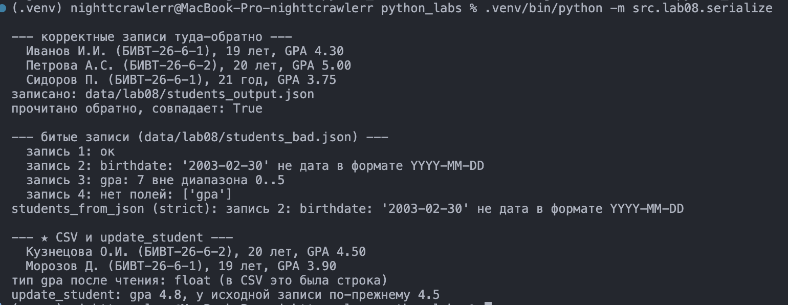

# Лабораторная 8 — запись Student как словарь

Модель данных без классов: запись это словарь с фиксированным набором ключей, а вся логика вынесена в функции. В коде нет `class`. Папки лабы строчными, как в задании: `src/lab08`, `data/lab08`, `images/lab08`. Запуск из корня проекта через `-m`.

Принятое решение: битые записи при чтении JSON обрабатываются по политике **strict**. Первая же ошибка прерывает чтение и поднимает `ValueError` с номером записи (с единицы) и причиной. Пропускать битые молча я не стал: программа, которая тихо работает с неверными данными, хуже той, что упала.

## Задание 1 — модель Student

Запись состоит из четырёх полей, перечень ключей лежит в константе `STUDENT_FIELDS`:
- `fio` — непустая строка;
- `birthdate` — строка `YYYY-MM-DD`, дата существует и не в будущем;
- `group` — непустая строка;
- `gpa` — число от 0 до 5 включительно, `int` приводится к `float`, `bool` не принимается.

Функции:
- `make_student` собирает запись и проверяет каждое поле. Это единственное место, где запись собирается, остальные функции идут через неё.
- `validate_student` проверяет готовый словарь: ключи ровно `STUDENT_FIELDS`, ничего лишнего и ничего пропущенного, и значения.
- `student_age` считает полные годы на дату `today`: человек, родившийся 2007-05-14, 13 мая 2026 ещё 18, а 14 мая уже 19.
- `format_student` печатает `Иванов И.И. (БИВТ-26-6-1), 19 лет, GPA 4.30`, с правильным склонением (21 год, 22 года, 25 лет).
- `student_to_dict` возвращает копию записи, а не ту же самую, и перед этим проверяет её.
- `student_from_dict` берёт из словаря ровно нужные ключи (лишние отбрасывает), приводит `gpa` к `float` и проверяет.

Дата проверяется через `date.fromisoformat`, а не регуляркой: `2003-02-30` проходит по формату, но такой даты нет. Дополнительно сверяется `isoformat()` с исходной строкой, потому что новые версии Python принимают и `20030215`.

Примеры:
```
>>> s = make_student("Иванов Иван Иванович", "2007-05-14", "БИВТ-26-6-1", 4.3)
>>> student_age(s, date(2026, 5, 13))
18
>>> student_age(s, date(2026, 5, 14))
19
>>> make_student("Иванов Иван", "2003-02-30", "БИВТ-26-6-1", 4)
ValueError: birthdate: '2003-02-30' не дата в формате YYYY-MM-DD
>>> make_student("Иванов Иван", "2007-05-14", "БИВТ-26-6-1", 7)
ValueError: gpa: 7 вне диапазона 0..5
```

Файл: `src/lab08/models.py`

## Задание 2 — сериализация

`students_to_json` сохраняет список записей массивом объектов с `ensure_ascii=False` и `indent=2`, каждая запись перед этим проверяется. `students_from_json` читает массив и прогоняет каждый объект через `student_from_dict`.

До и после на одной записи: во входном файле `gpa` целое, в выходном уже `float`.
```
data/lab08/students_input.json     "gpa": 5
data/lab08/students_output.json    "gpa": 5.0
```

Данные: `data/lab08/students_input.json`, `data/lab08/students_output.json` и `data/lab08/students_bad.json` с тремя битыми записями (несуществующая дата, `gpa = 7`, пропущенное поле).

Файл: `src/lab08/serialize.py`

## Задание 3 — проверка валидации

Один запуск показывает все сценарии: корректные записи туда-обратно (после чтения обратно списки совпадают), запись с неверной датой, запись с `gpa = 7` и запись без поля. В конце виден результат `students_from_json` на битом файле: строгая политика останавливается на второй записи. Последний блок показывает ★: чтение `data/lab08/students.csv` и `update_student`.

Запуск:
```
.venv/bin/python -m src.lab08.serialize
```

Файл: `src/lab08/serialize.py`
Скрин: 

## Задание 4 — со звёздочкой

`update_student(rec, **fields)` возвращает новую запись с изменёнными полями, исходная не меняется: `{**rec, **fields}` создаёт новый словарь. Неизвестный ключ даёт `KeyError`, неверное значение `ValueError`.

`students_from_csv` читает записи через `csv.DictReader`. Из CSV `gpa` приходит строкой, и лечится это один раз на входе, прямо в `students_from_csv`: там строка приводится к `float`, а `student_from_dict` строку в `gpa` намеренно не принимает.

Данные: `data/lab08/students.csv` (две записи, заголовок `fio,birthdate,group,gpa`).

Файлы: `src/lab08/models.py`, `src/lab08/serialize.py`
